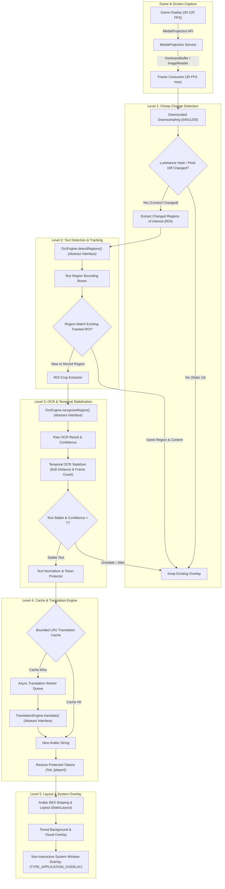

# Comprehensive Architecture Specification

## 1. HIGH-LEVEL SYSTEM OVERVIEW

The application is structured as an asynchronous, multi-rate, staged pipeline. Expensive machine-learning operations (Text Detection, OCR Recognition, Neural Machine Translation) are completely decoupled from game frame rates (30–120 FPS) and accessed strictly via modular abstract interfaces.



---

## 2. COMPONENT ABSTRACTION & PLUGGABILITY DESIGN

To preserve architectural stability regardless of benchmark outcomes, all ML components are isolated behind generic Kotlin interfaces:

```kotlin
/**
 * Abstract OCR Engine interface.
 * Allows swapping between LiteRT PP-OCRv4/v5, ONNX Runtime Mobile, or ML Kit fallback
 * without affecting pipeline control flow.
 */
interface OcrEngine {
    suspend fun detectRegions(frame: FrameBuffer): List<TextRegion>
    suspend fun recognizeRegion(crop: FrameBuffer): OcrResult
    fun getEngineMetadata(): EngineMetadata
}

/**
 * Abstract Offline Translation Engine interface.
 * Allows swapping between Opus-MT (MarianMT), quantized distilled NMT models, or ONNX runtimes
 * after empirical latency/quality benchmarking.
 */
interface TranslationEngine {
    suspend fun translate(text: String, sourceLang: String = "en", targetLang: String = "ar"): TranslationResult
    fun isWarm(): Boolean
    fun getEngineMetadata(): EngineMetadata
}
```

---

## 3. MULTI-RATE STAGED PIPELINE DESIGN

| Stage | Target Rate | Target Latency Budget | Execution Strategy | Verification Status |
| :--- | :--- | :--- | :--- | :--- |
| **Screen Capture** | 30 FPS | ~33 ms | `ImageReader` hardware buffer acquisition. Drops frames if worker is busy. | **VERIFIED API** |
| **Change Detection** | 15–30 FPS | ~5–10 ms | 4x downscaled greyscale difference against cached keyframe. | **DECISION** |
| **Text Detection** | 5–10 FPS | Target < 25 ms | Pluggable `OcrEngine.detectRegions()` (e.g. PP-OCRv4 Mobile Det). | **BENCHMARK REQUIRED** |
| **OCR Recognition** | 2–5 FPS | Target < 35 ms | Pluggable `OcrEngine.recognizeRegion()` (e.g. PP-OCRv4 Mobile Rec). | **BENCHMARK REQUIRED** |
| **Stabilization** | Every Frame | ~1–2 ms | Temporal frame voting buffer + Levenshtein distance check. | **DECISION** |
| **NMT Translation** | Asynchronous | Target < 100 ms | Pluggable `TranslationEngine.translate()` (Single bounded queue). | **BENCHMARK REQUIRED** |
| **Overlay Render** | On State Change | ~5–16 ms | Canvas draw calls onto non-interactive transparent overlay surface. | **VALIDATION REQUIRED** |

---

## 3B. SPATIAL TRACKING & STABILIZATION STATE MACHINE (PHASE 5, ADR-009)

Fleshes out the Level 2 → Level 3 handoff in the diagram above ("Region Match
Existing Tracked ROI?" + "Temporal OCR Stabilizer"):

* **Association**: `RegionTracker` matches detector boxes to persistent tracks
  (`track-N`) by IoU strictly greater than 0.6 — best overlap wins; exact ties
  resolve to the older track, then the earlier detection (fully deterministic, no
  wall-clock, no randomness). Unmatched detections open new tracks; unmatched
  tracks age and are removed after `maxMissedFrames` consecutive absences
  (default 3). Output order is track-creation order, NOT detector order.
* **Lifecycle per track**: `NEW → OBSERVING → STABLE ⇄ CHANGED`, with
  `DISAPPEARED` (frozen observation window, within grace) and `REMOVED` (past
  grace — later look-alikes start over). Stability needs a full 3-frame window
  mutually consistent within edit distance 1 of the window reference; a
  beyond-tolerance change restarts observation (bounded `windowSize`-frame delay
  before the new text replaces the old); within-tolerance drift advances
  `stableText` without leaving STABLE. Blank/below-confidence observations are
  dropped (freeze, don't corrupt).
* **Layer pairing rule**: tracker and stabilizer MUST share the same
  `maxMissedFrames` so a track expires on both layers in the same cycle; the
  stabilizer is keyed exclusively on `trackId` (cross-region isolation by
  construction). The live `OcrPipelineCoordinator` is not rewired until Phase 7;
  the tested composition is detections → `update()` → `prune()` → `stabilize()`.

---

## 4. HARDWARE ACCELERATION CANDIDATES & BACKEND SELECTION

Hardware acceleration backends are treated as **evaluated candidates**. The final production backend will be selected based on benchmark results on target physical hardware:

1. **Candidate 1: LiteRT OpenCL / Vulkan GPU Delegate**.
2. **Candidate 2: Qualcomm AI Engine Direct (QNN) Delegate** (for Snapdragon SoCs).
3. **Production Fallback: Multi-threaded CPU Execution** (XNNPACK backend, 4 threads allocated to ARM big.LITTLE performance cores).

---

## 5. OVERLAY & NON-INTERACTIVE DESIGN

The overlay is designed as a non-interactive rendering window over active games:

```kotlin
WindowManager.LayoutParams(
    WindowManager.LayoutParams.MATCH_PARENT,
    WindowManager.LayoutParams.MATCH_PARENT,
    WindowManager.LayoutParams.TYPE_APPLICATION_OVERLAY,
    WindowManager.LayoutParams.FLAG_NOT_FOCUSABLE or
    WindowManager.LayoutParams.FLAG_NOT_TOUCHABLE or
    WindowManager.LayoutParams.FLAG_LAYOUT_IN_SCREEN or
    WindowManager.LayoutParams.FLAG_LAYOUT_NO_LIMITS,
    PixelFormat.TRANSLUCENT
)
```

* **Validation Requirement**: While `FLAG_NOT_TOUCHABLE | FLAG_NOT_FOCUSABLE` is the standard Android API mechanism for touch pass-through, behavior must be explicitly validated across all supported Android versions and real game titles to ensure zero touch interception.

---

## 5B. OVERLAY RENDERING LAYER (PHASE 6, ADR-010)

Implements the Level 5 "Layout & System Overlay" boxes:

* **Text → layout → rendering split**: `OverlayRegion` (logical-order text + `OverlayRect` bounds + `OverlayStyle`) → `ArabicTextLayout` (`StaticLayout`, FIRSTSTRONG direction, no reversal/shaping of strings anywhere) → `OverlayRegionView.onDraw` (background box, stroke-then-fill outline, clip-to-bounds, per-region failure isolation).
* **Canonical coordinates**: overlay pixels = physical display pixels, current orientation. Integer capture boxes convert via `CoordinateMapper` (per-axis scale + offset + {0,90,180,270} rotation); capture-Float confusion is a compile error by distinct types.
* **Window**: `OverlayController` owns one full-screen TRANSLUCENT view (`TYPE_APPLICATION_OVERLAY`, NOT_FOCUSABLE|NOT_TOUCHABLE|LAYOUT_IN_SCREEN|LAYOUT_NO_LIMITS). All calls block-marshal to main with timeout (fail-closed); permission absence refuses without throwing; every `WindowManager` op is guarded. The view additionally refuses all touch events itself (belt-and-braces, dispatched-event tested). No bitmaps; layouts rebuild only on content change; `invalidate()` only then.
* **Hosting**: `OverlayService` (plain service, manifest-registered) translates SHOW/HIDE/STOP intents; controller is service-scoped (no static-held Context — StaticFieldLeak by construction), reached via `instance?.controller`. No regions through intents (same-process design). Rendering failures are caught per region and in lifecycle paths — they can never reach capture/translation.
* **Validation split**: pure models + UBA rules JVM-tested; `StaticLayout` shaping, window attach, dispatched-touch, lifecycle, and layout-build cost are `androidTest`-only (HONOR device, Stage B) plus a documented manual game-behind-overlay touch gate.

---

## 6. THERMAL & RESOURCE MANAGEMENT STRATEGY

Thermal budgets (e.g. target $\Delta T < 4^\circ\text{C}$) are performance targets/budgets, not proven pass/fail requirements, until empirical baseline measurements are established on physical hardware.

Using Android `PowerManager.OnThermalStatusChangedListener`:
* `THERMAL_STATUS_NONE / LIGHT`: 100% processing capacity.
* `THERMAL_STATUS_MODERATE`: Reduce OCR resolution by 25%, skip background UI text.
* `THERMAL_STATUS_SEVERE`: Drop frame capture rate to 10 FPS, rely strictly on translation cache.
* `THERMAL_STATUS_CRITICAL`: Pause detection/OCR pipeline until thermals normalize; render existing cached overlays.

---

## 7. INTEGRATED RUNTIME PIPELINE (PHASE 7, ADR-011)

Wires the staged components into one live dataflow (see the flowchart in §1):

```
CaptureThread (Image → FrameChangeDetector → FrameBuffer meta, flow-conflated)
  ↓ StateFlow (latest-only, never blocks producer)
OcrPipelineCoordinator worker (gates → detect → [tracker] → recognize-scheduled → stabilize → publish)
  ↓ StateFlow<List<OcrResult>> (conflated: identical lists do NOT re-emit!)
GameTranslatorPipeline worker, single thread (normalize → revision check → launch?)
  ↓ semaphore (permits, default 1) → translation pool → completions hop to worker
OverlaySink (controller marshals to main; view draws on change only)
```

* **Stage contracts**: capture emits metadata only (no pixels flow — the detector-seam gap is documented below); detection boxes are `TextRegion`s; with the tracker enabled every downstream id is a `track-N`; recognition is skipped for stable+static+fresh tracks (bounded re-verify); only `isStable` results translate; cache key is normalized text; overlay items carry logical-order Arabic + overlay-space bounds.
* **Stale-result protocol**: per-region monotonic revisions; completions verify revision on the worker and drop mismatches (triggering the latest text immediately); disappearance drops state and unpublishes on first absence; late post-stop completions die on the cancelled scope.
* **Backpressure**: no queues anywhere — shed-and-retry (permits) plus a 200 ms worker-side retry pump. The pump exists because conflated flows suppress repeated identical emissions: static content would otherwise stall shed/cold/failed work forever (measured stall pre-pump, resolved post-pump).
* **Lifecycle**: `start()` creates owned executors + scope and collects; `stop()` cancels, closes executors, clears state, detaches overlay; rapid start/stop is leak-free by construction (verified in tests).
* **Failure domains**: OCR throw → region skipped; NMT throw → previous overlay held + retry armed; sink throw/refusal → counted, retried next cycle; cold engine → launches deferred (no echo caching/overlay); overlay detach on stop is best-effort. No stage can crash another.
* **Known gap (Phase 9)**: pixel transport capture → OCR detector. `FrameBuffer` intentionally carries metadata only (zero-copy capture); a bounded pre-scaled snapshot path must be designed against real detector models — deliberately NOT built blind in Phase 7.

---

## 7B. REAL OCR PIXEL PATH (PHASE 9, ADR-013/ADR-014)

Closes the §7 gap without touching the conflated metadata flow:

```
CaptureThread (Image open)
  ├─ FrameChangeDetector (existing gate) ── unchanged? ──> FrameBuffer meta flow
  └─ changed + SnapshotStore.isDue? ──> SnapshotDownscaler (in-place RGBA reads,
      bilinear, ≤ 960 side, ~1.3 MB) ──> SnapshotStore.publish (CAS-swap, ≤ 5/s)
OcrPipelineCoordinator worker (unchanged code, real engine behind OcrEngine)
  ├─ detectRegions(frame): store.acquire() → DetPreprocess (max/960, /32 rint,
  │   BGR-swapped normalize) → DetSession (ORT CPU) → DbDecoder → frame-space
  │   boxes (clip, 3px filter, reading-order sort, det-N ids); snapshot pinned
  │   as the cycle's active frame. No snapshot / cold engine → empty (NoOp-shaped).
  └─ recognizeRegion(frame, region): crop active snapshot (frame→snap scale,
      tall-crop rot90) → RecPreprocess (48px, dynamic width ≤ 2048) → RecSession →
      CtcDecoder → text + score; below text_score 0.5 → empty (stabilizer freezes).
Tracker (track-N rewrite, grace 3) → stabilizer (window 3, grace 3, paired per
ADR-009) → GameTranslatorPipeline → TieredOverlaySink (all UNCHANGED).
```

* **Coordinate chain (single system, no second space)**: model-input px → (÷ map dims, × snapshot dims, rint+clip) → snapshot px → (÷ snapshot scale) → frame px (`BoundingBox`, ints) → existing `Viewport`/`CoordinateMapper` → overlay. Det padding never occurs (resize stretches to 32-rounded dims; both axis ratios tracked).
* **Bounds**: store ≤ 1 snapshot (~1.3 MB) + engine ≤ 1 active + transient downscale/input buffers per cycle (µs–ms lived); sessions load once, reused per frame/region; ORT inputs are direct buffers (heap buffers rejected — ISSUE-005 lineage), outputs copied out before `Result` close (single-ownership discipline).
* **Failure domains**: snapshot build fail → metadata-only cycle; no snapshot/cold → empty detect/recognize; malformed tensors → empty (no throw); per-region recognize fail → empty observation (freeze); session load fail → cold engine (pipeline idles); release → cold + snapshot dereferenced. No OCR failure reaches capture/translation/overlay.
* **Rates**: capture 30 Hz → changed+due ≤ 5 snapshots/s → detect ≤ 5 Hz → rec per region sequential (batch 1, no padding) → translate only stable text (unchanged). No per-frame full-res copies, no queues, no capture-thread inference.

---

## 5C. TIERED OVERLAY RENDERING (PHASE 8, ADR-012)

Sits between the Phase 7 pipeline and the Phase 6 window (`GameTranslatorPipeline → TieredOverlaySink → OverlayController → view`):

* **Policy vs renderer split**: `OverlayRenderTier` (TIER_1_COVER / TIER_2_MASK / TIER_3_TRANSPARENT) names the strategy; `OverlayRenderPolicy` answers "which tier for this region?" (`ExplicitOverlayRenderPolicy`: one default + per-region overrides, O(1) lookup, string-config parsing with Tier 3 fallback); `OverlayTierRenderer` answers "how?" as a PURE `OverlayStyle` transform (opaque cover / translucent mask / transparent + readability outline-or-shadow, id/bounds/text byte-identical). No automatic background-complexity detection yet — selection is explicit/configurable; a future detector plugs into the policy seam with no renderer or pipeline changes.
* **Reuse, not duplication**: bounds stay in the single canonical overlay-pixel system (`CoordinateMapper` upstream in the pipeline; the tier layer never remaps). Text stays logical-order (Phase 6 shaping path untouched). No bitmaps, no sampling, no full-screen work, no retained state — per-region cost is one map lookup plus one style copy.
* **Failure contract**: policy throw → Tier 3; Tier 1/2 renderer throw → one Tier 3 retry (text preserved); Tier 3 throw or unrenderable input (blank/degenerate, unfixable by any tier) → region dropped; delegate throw/refusal → counted, never rethrown. Sibling regions always render. Counts-only `TierRenderMetrics`/`TierRenderSnapshot` expose requests, fallbacks, drops, and delegate failures.
* **Wiring**: `MainActivity` drives the pipeline through `TieredOverlaySink(overlayController)` with the default all-Tier-3 policy — visually identical to the pre-Phase-8 path (default style already has an outline and no background, so Tier 3 is the identity transform). Per-region tiers become configurable at that construction site once a selection source exists.
